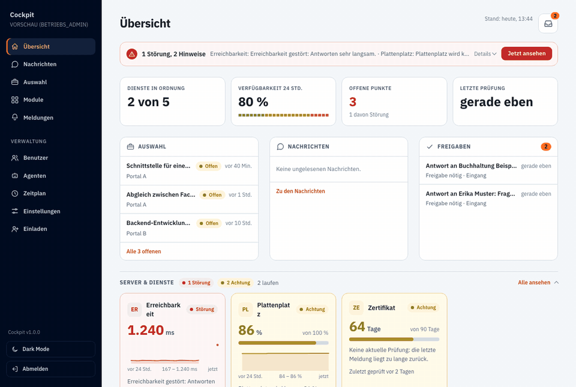

# Cockpit

**Das Betriebscockpit einer KI-Automatisierungsbox: sehen, was die Agenten tun, ihre Entwürfe mit einem Klick freigeben und die
Kontrolle behalten.**

[English](README.md) · [Apache-2.0](LICENSE) · [Mitmachen](CONTRIBUTING.md)



Das Cockpit ist ein kleiner Node.js-Dienst, der neben `n8n` und PostgreSQL läuft. Agenten (Workflows, Skripte, LLM-Werkzeuge)
melden ihm über eine dokumentierte API; Menschen sehen nach, entscheiden und geben frei. Nichts geschieht hinter deinem Rücken:
Das Cockpit liest und protokolliert, es führt von sich aus kein Update aus, verschickt keine Mail und löscht nichts.

## Was es kann

- **Zustand auf einen Blick:** Wachen melden Befunde (grün, gelb, rot), die Übersicht zeigt, was Aufmerksamkeit braucht.
- **Freigabe mit einem Klick:** Der Agent entwirft eine Antwort, du gibst frei, änderst oder übernimmst selbst.
- **Entscheidungen:** Agenten schlagen vor, du entscheidest, der Agent handelt danach.
- **Module deklariert statt programmiert:** ein YAML-Block plus eine SQL-View mit festen Spaltennamen, fünf Ansichtstypen, Rollen
  bestimmen die Sichtbarkeit.
- **KI-Verbrauch und Kosten** je Projekt, Ticket, Modell und Quelle.
- **Anhänge mit Warnseite**, nach Gefahr eingestuft; Ausführbares wird nie ausgeliefert.
- **Chat mit den Agenten,** als App installierbar, mit Web Push und E-Mail als zweitem Kanal.
- **Sicher gebaut:** Passkeys und zweiter Faktor, Rollen, strikte CSP, kein Docker-Socket, kein SSH, **nie physisch löschen**.
- **Updates sind Anträge, keine Aktionen.**

## Lokal ausprobieren

Node.js 24 und Docker. Die Demo füllt eine lokale Datenbank mit erfundenen Agenten, Modulen, Tickets und Kosten.

```bash
npm ci
./dev demo
./dev vorschau --rolle betriebs_admin
```

Danach <http://127.0.0.1:3100> öffnen. Den ganzen lokalen Stack mit Mail-Fänger und Watch-Modus startet `./dev up`.

## Weiterlesen

[`docs/handbuch.md`](docs/handbuch.md) (Handbuch) · [`docs/installation.md`](docs/installation.md) ·
[`docs/modul-vertrag.md`](docs/modul-vertrag.md) · [`docs/agenten-api.md`](docs/agenten-api.md) ·
[`docs/erweiterungen.md`](docs/erweiterungen.md) · [`docs/architektur-leitplanken.md`](docs/architektur-leitplanken.md)
