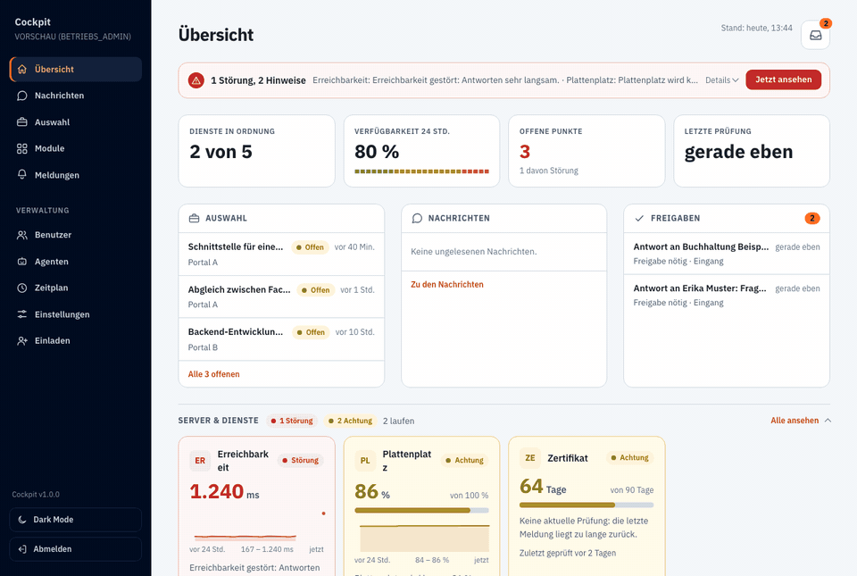

# Cockpit

**An operations cockpit for an AI automation box: see what your agents are doing, approve their drafts with one click, and stay in control.**

[Deutsch](README.de.md) · [Apache-2.0](LICENSE) · [Contributing](CONTRIBUTING.md)



Cockpit is a small Node.js service that runs next to `n8n` and PostgreSQL. Agents (workflows, scripts, LLM tools) report to it
over a documented API; people use its web interface to look, decide and approve. Nothing happens behind your back: Cockpit
reads and records, it never runs an update, sends a mail or deletes data by itself.

> The interface and most of the documentation are in German. This page and the contribution guide are in English.

## What it does

- **Status at a glance.** Watches report findings (green, yellow, red); the overview shows what needs attention, with history.
- **Approvals with one click.** An agent drafts a reply; you approve, edit or take over. The agent sends only what you approved.
- **Decisions.** Agents propose, you choose ("worth a look", "not interesting", "done"), the agent acts on your choice.
- **Modules declared, not programmed.** A module is a YAML block plus a SQL view with fixed column names. Five view types:
  list and detail, history, occupancy, tasks, key figures. Roles decide who sees what.
- **AI usage and cost.** Usage per project, ticket, model and source, in your currency, from the price list you keep.
- **Attachments with a warning page.** Classified by risk; executables are never delivered.
- **Chat with your agents,** installable as an app, with Web Push and e-mail as a second channel.
- **Safe by design.** Passkeys and a second factor, roles, a strict CSP, no Docker socket, no SSH, and **nothing is ever physically
  deleted**, only marked as deleted.
- **Updates are requests, not actions.** Cockpit asks; a separate, narrow tool carries it out after your approval.

## Try it locally

You need Node.js 24 and Docker. The demo fills a local database with invented agents, modules, tickets and costs.

```bash
npm ci
./dev demo       # start PostgreSQL, apply migrations, load the demo data
./dev vorschau --rolle betriebs_admin
```

Then open <http://127.0.0.1:3100>. Roles to try: `betreuer` (technical modules, AI usage), `betriebs_admin` (business modules),
`betrieb_mitarbeiter`. The full local setup, with mail catcher and watch mode, is `./dev up`.

## How it is built

TypeScript (strict), Fastify with server-side rendering (Eta), Turbo and Stimulus, Tailwind, Better Auth, PostgreSQL in its
own schema, Server-Sent Events. One process, one container, no Redis, no extra service. The architecture rules that must not move
without a deliberate decision are in [`docs/architektur-leitplanken.md`](docs/architektur-leitplanken.md).

## Documentation

| | |
| --- | --- |
| [`docs/handbuch.md`](docs/handbuch.md) | The manual (German): setup, configuration, every page and endpoint |
| [`docs/installation.md`](docs/installation.md) | Install an instance, update, roll back |
| [`docs/modul-vertrag.md`](docs/modul-vertrag.md) | Module contract: the `cockpit:` block and the SQL view |
| [`docs/agenten-api.md`](docs/agenten-api.md) | The API agents use to report findings, drafts and usage |
| [`docs/erweiterungen.md`](docs/erweiterungen.md) | Extending the core: extension point and using the core as a package |

## Status and license

Version 1.x. The public core is Apache-2.0; module blueprints and agent configurations of individual installations are not part
of it. Questions and bug reports are welcome as issues. See [`CONTRIBUTING.md`](CONTRIBUTING.md) before opening a pull request.
